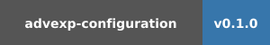

# Advexp.Settings for Python

The packages on PyPI:

<a href="https://pypi.org/project/advexp-settings/" target="_blank" rel="noopener noreferrer"></a>

<a href="https://pypi.org/project/advexp-configuration/" target="_blank" rel="noopener noreferrer"></a>

The full documentation lives at <a href="https://docs.advexp.net" target="_blank" rel="noopener noreferrer">https://docs.advexp.net</a>.

**Advexp.Settings** — loads and saves typed settings through pluggable
backends: environment variables, dotenv, JSON, TOML and YAML files.

**Advexp.Configuration** — the read-only counterpart, loads the same
declarations from its sources without write-back. The packages share the
declaration syntax, the conversion contract, validation and the plugin
API — a class migrates between them by changing the base class and the
imports.

## A quick example

Settings are declared as members of a `Settings` subclass; each member is
assigned an attribute that selects its backend. All operations are
class-level:

```python
from datetime import timedelta

import advexp.settings as adv_settings
import advexp.settings.plugins.environment.variables as env


class AppSettings(adv_settings.Settings):
    debug: bool = env.environment_variable_setting(
        name="APP_DEBUG", default=False
    )

    # APP_SESSION_TTL=1:30:00 in the environment
    session_ttl: timedelta = env.environment_variable_setting(
        default="0:30:00"
    )


AppSettings.load_settings()

# datetime.timedelta(seconds=5400) — parsed, not a string
print(repr(AppSettings.session_ttl))

# just assign — values are stored per class
AppSettings.debug = True

# write every setting back to its backend
AppSettings.save_settings()
```

Members are declared through the backend's factory function, as above —
the spelling static checkers accept. Importing a plugin module is what
enables the plugin; no registration calls are needed.

## Documentation

- <https://docs.advexp.net> — the full documentation: the guides, the
  value types, validation, dynamic settings, and the API reference
  generated from the docstrings.
- [advexp-settings](https://docs.advexp.net/settings/) and
  [advexp-configuration](https://docs.advexp.net/configuration/) — the
  packages' overview pages on the documentation site.
- [samples/](samples/) — runnable tours of both packages' APIs.

## Repository layout

```
packages/            packaging catalogs of the distributions — metadata
                     plus a src symlink into the shared source tree
src/advexp/          the shared source tree — a PEP 420 namespace package
  settings_base/     the family foundation: context, conversion, contracts
  settings/          the settings package; plugins/ holds its backends
  configuration/     the configuration package; plugins/ holds its sources
tests/               pytest suites per package plus the packaging guards
samples/             runnable examples per package
docs-site/           the documentation site sources
```

## Development

Python 3.9 or later. The packages install editable in dependency order —
the foundation first:

```bash
python -m venv .venv
source .venv/bin/activate
pip install -e packages/advexp-settings-base
pip install -e "packages/advexp-settings[dev]"
pip install -e "packages/advexp-configuration[dev]"

pytest  # the test suite
```

## License

Apache License 2.0 — the full texts live in [LICENSES](LICENSES) and in
the packages.
